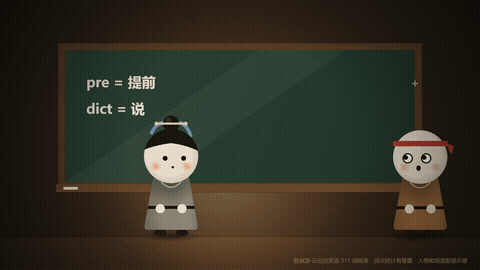
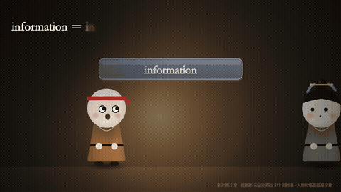

# english-animate · 英语动画 skill

把一篇英语知识点交给 AI，它给你一支 Q 版小人讲解动画片：彩色字母积木拼词、词海退潮、黑板剪刀线拆词，配微软晓晓旁白 + 卡通拟音 + 逐字字幕，1080p30 成片。全代码画帧零积分，不用 AI 生图、不用视频平台。

**在线效果展示页（免登录）**：http://117.72.219.84:29215/english133/




## 安装

### 方式一：官方技能安装器（推荐）

```bash
npx skills add Fizz0x11/english-animate-skill
```

覆盖 70+ 智能体（Claude Code / Codex / Cursor / ZCode 等共享 `~/.agents/skills/`）。

### 方式二：zip 手动装

下载 [english-animate-skill.zip](http://117.72.219.84:29215/english133/english-animate-skill.zip)（26MB），解压 `english-animate/` 到 `~/.agents/skills/`（Windows：`C:\Users\你的用户名\.agents\skills\`）。

### 或者：一句话让 AI 替你装

把展示页上的「安装提示词」复制给你的 AI 即可（含 zip 直链，AI 全自动）。

## 环境四件套

| 依赖 | 自查 | 缺了装 |
|---|---|---|
| Node 18+ | `node --version` | nodejs.org |
| ffmpeg 7.x | `ffmpeg -version` | gyan.dev essentials |
| Chrome | 默认路径存在 | google.com/chrome |
| Python + edge-tts | `python -c "import edge_tts, numpy, scipy"` | `pip install edge-tts numpy scipy` |

## 验收三步

1. `cd english-template && npm install && node render.mjs stills 1,5,9` —— 三张截图（Q 版小人+积木+中文粗宋字幕）= 引擎装好
2. `node render.mjs video 0,15 --out=t15` + 混音 —— 15 秒有声有画 = 渲染链通
3. 改 `narration.json` 一句重跑 `python -X utf8 tts_build.py` —— 时长表变了 = 能自己产片

## 换内容出新片

改 `narration.json`（分页旁白）→ `tts_build.py` 测时长 → 定 `page_starts.json` → 复用 `scenes.js` 道具（block 三色积木 / wordSea 词海 / blackboard 黑板 / cutFlash 拆词线）→ 渲染混音。demo 是一支 76 秒的英语词根速成片（311 词根撬 5500 考研词系列之一）。

## 版权

引擎层来自 [chibi-history-explainer](https://github.com/)（MIT, (c) 2026 yiyu5331）；英语教学层（积木/词海/黑板道具、TTS 旁白产线、demo 文案）为本包自制，MIT 同权分发，见 [LICENSE](LICENSE)。
